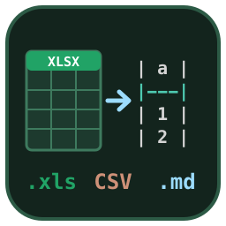

# Excel to Markdown Table & CSV to Markdown for VS Code

Zovo Pro: USD 19 once, every Zovo tool. Converting whole workbooks, saving Markdown tables as .xlsx and keeping Excel formats are Pro, with 3 free tries each; paste, convert and preview stay free.

Copy cells in Excel, Google Sheets, Numbers or LibreOffice Calc and paste them into a Markdown file as a clean Markdown table. Convert CSV and TSV to Markdown and back, line up the columns of an existing table, and open `.xlsx`, `.xls`, `.ods` and `.csv` files to copy a whole sheet or a range such as `A1:D20`. Works offline, with no network calls.

## Paste from Excel or Google Sheets

1. Copy cells in your spreadsheet.
2. In a Markdown file, right-click and pick Paste as Markdown Table (or run it from the Command Palette).

What you get:

- The first row becomes the header (or add an empty header with `excelToMarkdown.headerRow`).
- Columns that hold only numbers are right-aligned, including `1,250`, `$12.50`, `12%` and `(35)`.
- Pipes (`|`) and backslashes are escaped, so a cell like `A|B` stays in one column.
- A line break inside a cell becomes ` `. Cells with tabs or line breaks, which Excel and Google Sheets wrap in quotes, come out right.
- `<` and `>` in cells are written as `&lt;` and `&gt;`, so HTML in a cell shows as text when the Markdown is rendered.
- Columns line up in the editor, also with Chinese, Japanese and Korean text and emoji, which take two columns each.
- Ragged rows are filled with empty cells.

Normal paste (Cmd+V or Ctrl+V) is never changed. To paste tables with a key of your own, run Excel to Markdown: Add a keybinding for Paste as Markdown Table and pick, for example, Cmd+Alt+V or Ctrl+Alt+V.

## Copy a sheet or range from a workbook

Right-click an `.xlsx`, `.xlsm`, `.xlsb`, `.xls`, `.ods`, `.csv` or `.tsv` file and pick Open Spreadsheet as Markdown Table. Choose the sheet, type a range (`A1:D20`, `B:D`, `2:10`) or leave it empty for the whole sheet, then Copy or Insert at cursor. The same table can also be written as HTML, AsciiDoc, Jira, CSV or TSV.

Cells come as they are stored: plain numbers and dates in ISO form (2026-01-05).

## Convert and format tables

| Command | What it does |
|---|---|
| Convert CSV/TSV to Markdown Table | The selected CSV or TSV text becomes a Markdown table. In a `.csv` file with nothing selected, the whole file opens as a table in a new tab |
| Convert Markdown Table to CSV / to TSV | The table under the cursor becomes CSV or TSV again (` ` back to a line break, escapes undone) |
| Format Markdown Table | Pads the table under the cursor so the pipes line up, and keeps its alignment row |

## Free and Pro

Everything above is free, with no limit and no sign-in. Three Zovo Pro tools save time on bigger jobs. Each has 3 free tries on your computer, and a try counts only when the tool gives you a result.

| Tool | Free | Zovo Pro |
|---|---|---|
| Paste as Markdown table, CSV/TSV to Markdown and back, format tables, workbook preview with sheet and range, HTML, AsciiDoc, Jira | yes | yes |
| Convert whole workbooks to Markdown files: every sheet of a workbook, or every workbook in a folder, to `.md` files with one heading per sheet | 3 tries | yes |
| Save Markdown tables as an Excel file: every table of a document in one `.xlsx`, one sheet per table named after the heading above it, numbers stored as numbers | 3 tries | yes |
| Keep Excel formats, links and merged cells: cells as Excel shows them (`1,234.50 USD`, `25%`, `1 Jan 2024`), hyperlinks as Markdown links, merged cells filled into every cell they cover | 3 tries | yes |

Zovo Pro is USD 19 once and turns on the Pro tools in every Zovo extension. Nothing about Pro shows when you open a file or paste a table; it only comes up when you click one of the three tools. To hide them, set `excelToMarkdown.showProTools` to `false`.

## Settings

| Setting | Default | What it does |
|---|---|---|
| `excelToMarkdown.alignment` | `auto` | `auto` (numbers right), `left`, `center`, `right` or `none` |
| `excelToMarkdown.headerRow` | `first` | `first` row as header, or an `empty` header row |
| `excelToMarkdown.maxColumnWidth` | `40` | Cells wider than this are not padded, so one long cell does not stretch every row. `0` pads every cell |
| `excelToMarkdown.compact` | `false` | Tables without padding |
| `excelToMarkdown.escapeHtml` | `true` | Write `<` and `>` as `&lt;` and `&gt;` |
| `excelToMarkdown.escapeMarkdown` | `false` | Also escape `*` `_` `` ` `` `[` `]` `#` `~` |
| `excelToMarkdown.lineBreaks` | ` ` | Line breaks in cells as ` ` or a space |

## Safe with any file

- Workbooks are read in a separate worker thread with a time and memory limit. A broken or hostile file gives a message; it cannot freeze VS Code.
- Zip bombs are refused before the workbook is read: the number of parts and the unpacked size are capped, and a part that unpacks to more than it claims is rejected.
- Pastes up to 10 MB, 200,000 rows and 2,000 columns are converted; anything larger gives a message instead of a frozen editor.
- No network and no telemetry. The preview gets every cell from VS Code, not from the internet. The extension reads the clipboard only when you run Paste as Markdown Table, and writes it only when you click Copy.

## Commands

| Command | Where |
|---|---|
| Excel to Markdown: Paste as Markdown Table | Command Palette, right-click in a Markdown file |
| Excel to Markdown: Convert CSV/TSV to Markdown Table | Command Palette |
| Excel to Markdown: Convert Markdown Table to CSV / to TSV | Command Palette |
| Excel to Markdown: Format Markdown Table | Command Palette, right-click in a Markdown file |
| Excel to Markdown: Open Spreadsheet as Markdown Table | Command Palette, right-click a spreadsheet in the Explorer |
| Excel to Markdown: Open the sample workbook | Command Palette, walkthrough |
| Excel to Markdown: Convert workbooks to Markdown files (Pro) | Command Palette, right-click a workbook or folder |
| Excel to Markdown: Save Markdown tables as an Excel .xlsx file (Pro) | Command Palette |

## Third-party code

Workbooks are read and written with [SheetJS Community Edition](https://sheetjs.com) 0.20.3 (Apache License 2.0), bundled in the extension. See `THIRD-PARTY-NOTICES.txt`.

## Support Zovo

Zovo Pro: USD 19 once, every Zovo viewer. [Get Zovo Pro on GitHub Sponsors](https://github.com/sponsors/theluckystrike/sponsorships?tier_id=679878) to turn on the Pro tools in this extension and in the other Zovo extensions you use. The free features stay free.

Zovo extensions have no ads and no tracking. They are made by [theluckystrike](https://github.com/theluckystrike) on GitHub. You can also support the work with no Pro:

- [Sponsor on GitHub](https://github.com/sponsors/theluckystrike)
- [PayPal](https://www.paypal.com/paypalme/najzzz)
- [Follow theluckystrike on GitHub](https://github.com/theluckystrike)

### Need your format supported?

Open a [format request](https://github.com/theluckystrike/excel-to-markdown-vscode/issues/new?template=format-request.yml) with a sample file, and I reply there whether it can be done. For USD 299 once, through [this GitHub Sponsors tier](https://github.com/sponsors/theluckystrike/sponsorships?tier_id=679995), I add your file format or a missing feature to this extension, with tests, within 7 days.

## More tools by Zovo

- [XLSX Viewer, Excel Viewer, CSV Viewer & Parquet Viewer (XLS, CSV Preview)](https://marketplace.visualstudio.com/items?itemName=zovo.table-viewer-vscode) opens CSV, TSV, Excel and Parquet files as a sortable, filterable table.
- [PDF Viewer & PDF Reader to Read and View PDF (Dark Mode)](https://marketplace.visualstudio.com/items?itemName=zovo.pdf-viewer-dark) reads PDFs with a real dark mode, search, an outline and thumbnails.
- [DOCX Viewer & ODT Viewer, Word Document Preview (Dark Mode)](https://marketplace.visualstudio.com/items?itemName=zovo.docx-viewer-vscode) previews Word and ODT files with dark mode, an outline and search.
- [PPTX Viewer & PowerPoint Preview, PPT Presentation Slideshow](https://marketplace.visualstudio.com/items?itemName=zovo.pptx-slide-viewer) shows PowerPoint slides, thumbnails and speaker notes.
- [SQLite Editor & Viewer, SQLite3 Database Browser (Edit Cells, CSV Import)](https://marketplace.visualstudio.com/items?itemName=zovo.sqlite-table-viewer) browses SQLite tables read-only and runs SELECT queries.

See [all Zovo extensions on the Marketplace](https://marketplace.visualstudio.com/publishers/zovo).

## License

MIT
